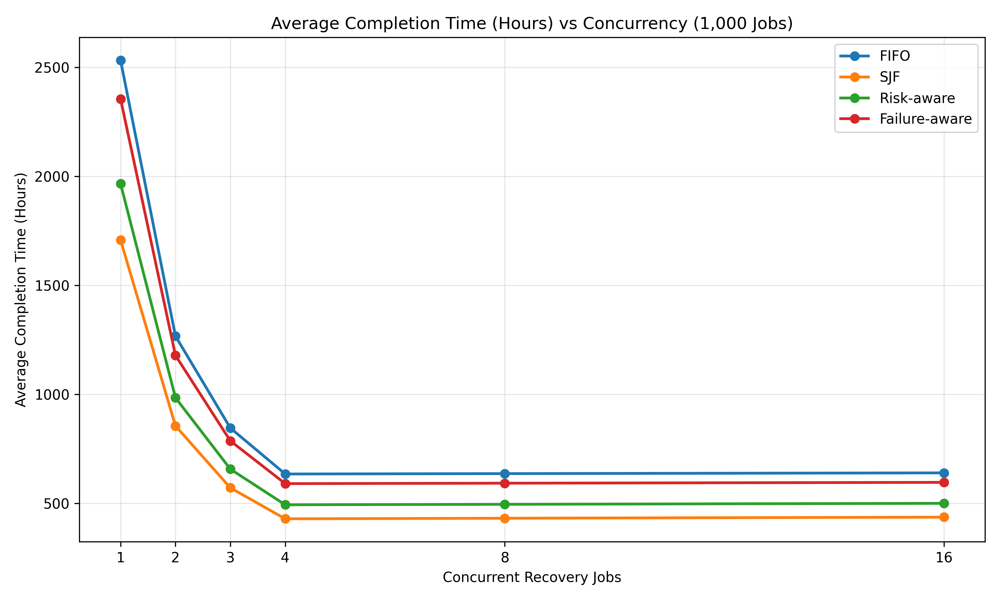
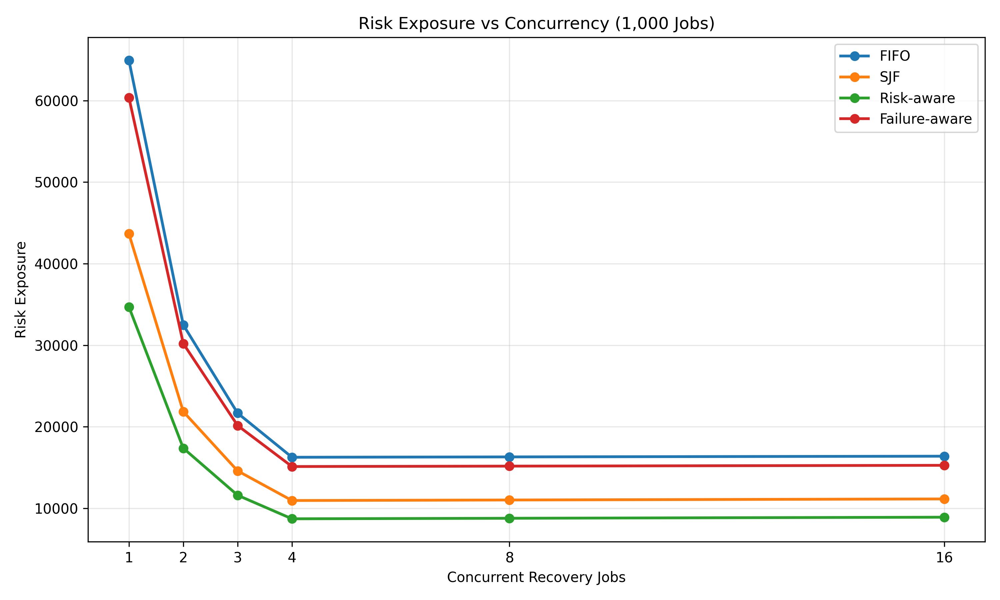
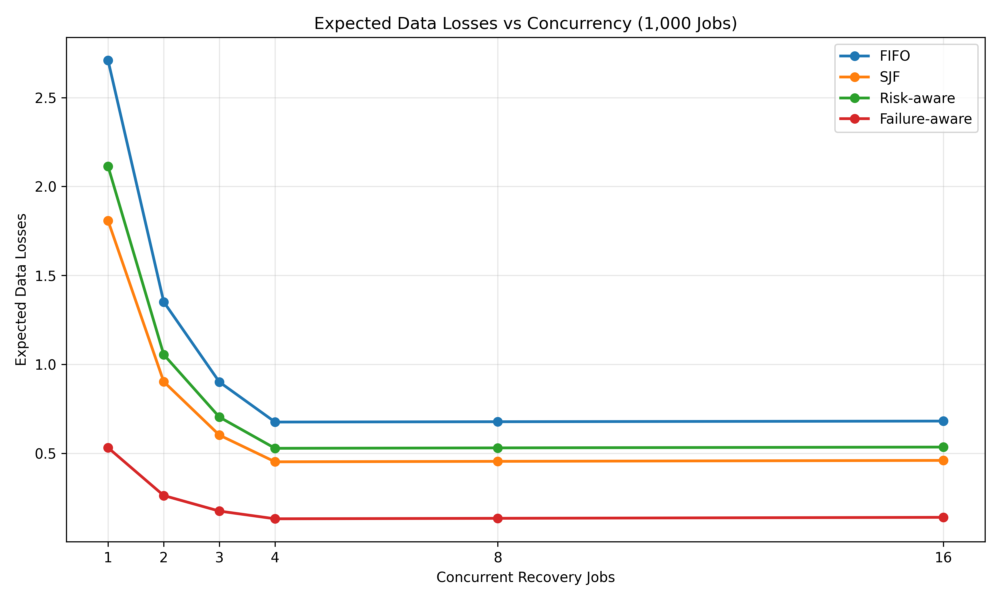
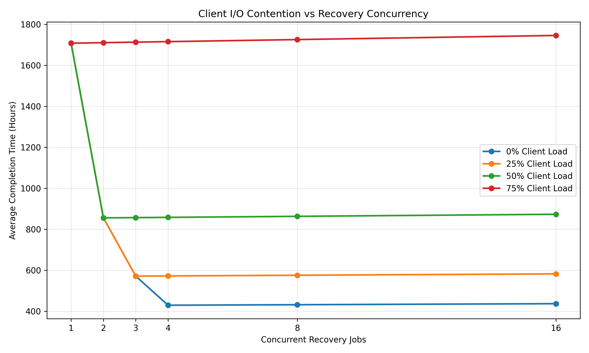

# RebuildIQ

**A C++20 storage recovery simulator for evaluating scheduling strategies, parallel recovery, and bandwidth contention.**

RebuildIQ investigates how recovery scheduling affects completion time, risk exposure, and expected data loss in replicated storage systems.

It implements four scheduling algorithms and evaluates their performance across different workload sizes, concurrency levels, and client I/O demands.

## Features

- **FIFO:** Recovers jobs in their original order.
- **Shortest Job First (SJF):** Prioritises jobs with smaller recovery sizes.
- **Risk-aware:** Prioritises jobs based on their risk relative to recovery size.
- **Failure-aware:** Prioritises jobs according to their estimated contribution to data-loss risk.
- **Parallel recovery:** Simulates multiple concurrent recovery jobs with per-job disk bandwidth and shared system bandwidth constraints.
- **Client I/O contention:** Models the reduction in recovery bandwidth caused by foreground client activity.
- **Benchmarking:** Compares scheduling algorithms using recovery time, risk exposure, expected data losses, and scheduling execution time.

## Build and Run

### Requirements

- C++20-compatible compiler
- CMake
- Python 3 with Pandas and Matplotlib for visualisations

### Build

From the project root:

```powershell
cmake -S . -B build
cmake --build build --config Release
```

### Run Tests

```powershell
ctest --test-dir build -C Release --output-on-failure
```

### Run Benchmarks

```powershell
.\build\Release\rebuildiq.exe
```

The executable evaluates the scheduling algorithms across the benchmark configurations defined in `src/main.cpp` and produces CSV results.

### Generate Visualisations

Save the benchmark CSV as `results/results.csv`, then run:

```powershell
pip install pandas matplotlib
python scripts/plot_results.py
```

The generated graphs are saved in `results/plots/`.

## Scheduling Algorithms

### First In, First Out (FIFO)

Processes recovery jobs in their original order.

FIFO provides a baseline for evaluating scheduling strategies that use job size, risk, or failure probability.

### Shortest Job First (SJF)

Sorts recovery jobs by ascending data size.

By recovering smaller jobs first, SJF reduces the average time jobs spend waiting for recovery to complete.

### Risk-aware Scheduling

Prioritises recovery jobs according to their risk-to-size ratio.

```text
priority = risk / size
```

Jobs with greater risk relative to their recovery size are scheduled first.

### Failure-aware Scheduling

Uses each job's estimated probability of complete replica loss to determine recovery priority.

The scheduler greedily selects jobs based on the expected reduction in data-loss risk, accounting for recovery duration, failure rate, and replica count.

## Parallel Recovery

RebuildIQ uses an event-driven simulation to model concurrent recovery jobs.

Each active job can use up to one disk's recovery bandwidth. Total throughput is limited by the available system bandwidth.

```text
total_capacity = min(
    active_jobs * disk_bandwidth,
    available_system_bandwidth
)

bandwidth_per_job = total_capacity / active_jobs
```

The simulator advances to the next job completion, updates the remaining data for all active jobs, records completed jobs, and admits new jobs from the scheduling queue.

This continues until all recovery jobs have finished.

### Client I/O Contention

Foreground client activity reduces the bandwidth available for recovery.

```text
available_bandwidth =
    system_bandwidth * (1 - client_load_fraction)
```

For example, with a system bandwidth of 400 GB/hour and a client load of 50%, recovery jobs have 200 GB/hour available.

## Benchmark Methodology

The benchmark evaluates four scheduling algorithms across multiple workload sizes, random seeds, concurrency levels, and client I/O loads.

| Parameter | Values |
| --- | --- |
| Recovery jobs | 100, 1,000, 10,000 |
| Random seeds | 20 |
| Scheduling algorithms | FIFO, SJF, Risk-aware, Failure-aware |
| Concurrency levels | 1, 2, 3, 4, 8, 16 |
| Client I/O load | 0%, 25%, 50%, 75% |
| Disk bandwidth | 100 GB/hour |
| System bandwidth | 400 GB/hour |

A total of **5,760 benchmark configurations** were evaluated.

Each recovery job contains:

- Job ID
- Recovery size
- Replica count
- Risk weight
- Failure rate

Results are aggregated across 20 random seeds for each configuration.

## Results

### Scheduling Algorithm Comparison

The following results use 1,000 recovery jobs, concurrency level 4, and 0% client I/O load, averaged across 20 random seeds.

| Algorithm | Avg. completion time (hours) | Risk exposure | Expected data losses |
| --- | ---: | ---: | ---: |
| FIFO | 634.42 | 16,267.57 | 0.6753 |
| SJF | **428.89** | 10,964.49 | 0.4517 |
| Risk-aware | 493.20 | **8,723.35** | 0.5276 |
| Failure-aware | 590.25 | 15,130.81 | **0.1313** |

The algorithms optimise different aspects of recovery performance:

- **SJF** achieves the lowest average completion time, reducing it by 32.4% compared with FIFO.
- **Risk-aware** achieves the lowest risk exposure, reducing it by 46.4% compared with FIFO.
- **Failure-aware** achieves the lowest expected data losses, reducing them by 80.6% compared with FIFO.

### Completion Time vs Concurrency



Increasing concurrency from 1 to 4 reduces average completion time by approximately 75% across all four scheduling algorithms at 0% client load.

Beyond concurrency level 4, completion times increase slightly because the available system bandwidth is already saturated.

SJF achieves the lowest average completion time across the tested concurrency levels.

### Risk Exposure vs Concurrency



Risk exposure decreases substantially as concurrency increases from 1 to 4.

At concurrency level 4, risk-aware scheduling achieves a risk exposure of 8,723.35, compared with 16,267.57 for FIFO.

Increasing concurrency beyond the available bandwidth limit produces a small increase in risk exposure.

### Expected Data Losses vs Concurrency



Expected data losses follow a similar trend, decreasing as additional recovery bandwidth is utilised.

Failure-aware scheduling achieves the lowest expected data losses across the tested concurrency levels.

At concurrency level 4, failure-aware scheduling produces 0.1313 expected data losses, compared with 0.6753 for FIFO.

### Client I/O Contention



The amount of bandwidth available for recovery determines the most effective concurrency level.

| Client I/O load | Available recovery bandwidth | Optimal concurrency |
| --- | ---: | ---: |
| 0% | 400 GB/hour | 4 |
| 25% | 300 GB/hour | 3 |
| 50% | 200 GB/hour | 2 |
| 75% | 100 GB/hour | 1 |

At 0% client load, four concurrent recovery jobs can fully utilise the available system bandwidth.

At 50% client load, only two concurrent jobs are required to reach the reduced bandwidth limit.

Additional concurrency beyond this point increases competition for bandwidth without increasing total recovery throughput.

## Evaluation Metrics

### Average Completion Time

Measures the average time required for recovery jobs to finish.

```text
average_completion_time =
    sum(completion_times) / number_of_jobs
```

### Risk Exposure

Measures the accumulated risk associated with unfinished recovery jobs.

```text
risk_exposure =
    sum(job_risk * completion_time)
```

Higher-risk jobs contribute more to the metric when their recovery takes longer.

### Expected Data Losses

Estimates the expected number of jobs that lose all replicas before recovery completes.

For a job with failure rate `lambda`, completion time `t`, and `r` replicas:

```text
probability_of_data_loss =
    (1 - exp(-lambda * t)) ^ r
```

Expected data losses are calculated by summing the individual probabilities across all jobs.

```text
expected_data_losses =
    sum(probability_of_data_loss)
```

### Scheduling Execution Time

Measures the time required to compute a recovery schedule, excluding the recovery simulation.

This allows the scheduling algorithms to be compared in terms of computational overhead as well as recovery performance.

## Testing

RebuildIQ includes 15 C++ test functions covering scheduling behaviour, recovery calculations, concurrency, and input validation.

The tests cover:

- FIFO recovery
- Shortest Job First scheduling
- Risk-aware scheduling
- Failure-aware scheduling
- Risk exposure calculations
- Data-loss probability calculations
- Expected data-loss calculations
- Shared-bandwidth concurrency
- Client I/O contention
- Parallel recovery
- System bandwidth limits
- Unequal recovery job sizes
- Parallel recovery under client contention
- Input validation
- Synthetic workload generation

Run the tests using:

```powershell
ctest --test-dir build -C Release --output-on-failure
```

## Project Structure

```text
RebuildIQ/
├── include/
│   └── recovery.hpp
├── src/
│   ├── recovery.cpp
│   └── main.cpp
├── tests/
│   └── test_recovery.cpp
├── scripts/
│   └── plot_results.py
├── results/
│   ├── results.csv
│   └── plots/
│       ├── completion_time_vs_concurrency.png
│       ├── risk_exposure_vs_concurrency.png
│       ├── expected_losses_vs_concurrency.png
│       └── client_contention.png
├── CMakeLists.txt
└── README.md
```
